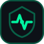
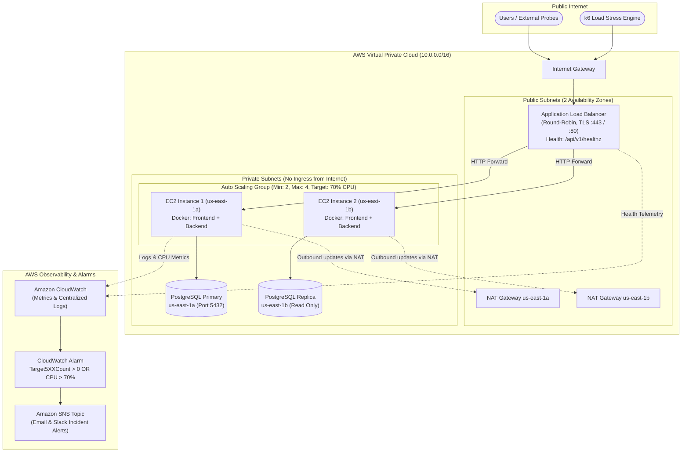

<p align="center">
  
</p>

<h1 align="center">PulseWatch</h1>

<p align="center">
  <strong>Next-Gen Cloud Uptime & Edge Latency Observability Engine</strong><br>
  <em>A High-Availability, Fault-Tolerant Microservices Platform Deployed with a 12-Stage DevSecOps Pipeline on AWS</em>
</p>

<p align="center">
  
  
  
  
  
  
  
  
</p>

---

## 🌟 Executive Summary & Product Vision

**PulseWatch** is an enterprise-grade cloud observability and synthetic uptime monitoring platform inspired by **Better Stack**, **Datadog**, and **Incident.io**. It is architected from the ground up to embody the core tenets of modern **DevSecOps**: end-to-end automation, shift-left security, high availability across multiple AWS Availability Zones, autonomous auto-scaling under load, and instant self-healing rollbacks.

### Key Capabilities
* **Interactive 3D Infrastructure Topology:** Real-time visualization of dual-AZ VPC, Application Load Balancers, EC2 auto-scaling instances, and database replicas.
* **Better Stack-Style Heartbeat Strips:** 60-day interactive uptime status bars with hover latency metrics and SLA verification.
* **Global Edge Radar:** Multi-region synthetic pings across `us-east-1`, `eu-central-1`, `ap-south-1`, `ap-northeast-1`, and `sa-east-1`.
* **One-Click Public Status Page:** Live SLA status portal displaying component health and historical incident post-mortems.
* **DevOps Failure & Scaling Simulator:** Built-in interactive lab allowing evaluators to inject 503 faults, trigger CloudWatch/SNS alarms, and dispatch k6 load spikes to observe ASG scale-out.

---

## 👥 Engineering Team & Contributions

| Member | Email | Role & Core Responsibilities |
| :--- | :--- | :--- |
| **Jabeen Zahra** | `kaneezezahra313@gmail.com` | **Architecture, Microservices & Frontend Platform Lead**<br>• Designed the React 18 frontend with Better Stack dark-glassmorphism and 3D topology.<br>• Engineered FastAPI REST microservice, health probes (`/healthz`, `/live`, `/ready`).<br>• Built Stages 1–4 of GitHub Actions CI pipeline and root Docker Compose. |
| **Fatima Ijaz** | `f6618568@gmail.com` | **DevSecOps, Security Auditing & Container Hardening Specialist**<br>• Hardened multi-stage Dockerfiles with unprivileged users (`appuser`, `nginx`).<br>• Integrated Gitleaks, Snyk dependency scanner, and Trivy container vulnerability audits.<br>• Authored `SECURITY.md`, ShellCheck-compliant `scripts/backup_db.sh`, and Dependabot policy. |
| **Mirfaq Javaid** | `mirfaqjavaid@gmail.com` | **Cloud Infrastructure, Observability & Continuous Delivery Lead**<br>• Engineered AWS Dual-AZ VPC, Internet Gateway, ALB, and Auto Scaling Group.<br>• Built OIDC IAM authentication, Amazon ECR tag immutability, and rolling deployment.<br>• Created Stage 12 `scripts/smoke_test.sh` with automated rollback and k6 load test script. |

---

## 🏛️ System Architecture



---

## 🛡️ Required 12-Stage DevSecOps Pipeline

```mermaid
flowchart LR
    subgraph CI ["Continuous Integration (Runs on Every Push & PR)"]
        S1["1. Gitleaks<br/>(Secret Scan)"] --> S2["2. ESLint<br/>(Code Lint)"]
        S2 --> S3["3. Prettier<br/>(Format Check)"]
        S3 --> S4["4. Hadolint<br/>(Dockerfile Lint)"]
        S4 --> S5["5. Pytest<br/>(Unit Tests >80%)"]
        S5 --> S6["6. SonarCloud<br/>(Static Analysis)"]
        S6 --> S7["7. Snyk<br/>(Dep Audit)"]
        S7 --> S8["8. Docker Build<br/>(Multi-stage)"]
        S8 --> S9["9. Trivy<br/>(Image Scan)"]
        S9 --> S10["10. Verification<br/>(Approval Gate)"]
    end

    subgraph CD ["Continuous Delivery (Runs on Merge to main)"]
        S10 --> S11["11. Amazon ECR Push<br/>+ Rolling Deploy via SSM"]
        S11 --> S12["12. ALB Smoke Test<br/>(scripts/smoke_test.sh)"]
        S12 -->|Success| LiveApp(["Live Production"])
        S12 -->|Failure| Rollback["Auto Rollback<br/>(Previous ECR Digest)"]
    end
```



### Pipeline Stage Details
1. **Secret Scanning:** Gitleaks scans the complete repository history. Fails on any exposed secret.
2. **Linting:** ESLint enforces clean React & TypeScript code quality without warnings.
3. **Formatting Check:** Prettier verifies code formatting consistency across the repository.
4. **Dockerfile Linting:** Hadolint inspects Dockerfiles against container security best practices.
5. **Unit Tests & Coverage:** Pytest executes test suite requiring **>= 80% code coverage**.
6. **Static Analysis:** SonarCloud verifies code complexity, maintainability, and security hotspots.
7. **Dependency Scanning:** Snyk audits Python and Node packages. Fails on any High/Critical CVE.
8. **Container Image Build:** Docker Buildx compiles multi-stage Alpine images.
9. **Container Image Scan:** Trivy scans image layers with `exit-code: 1` on High/Critical vulnerabilities.
10. **Pre-Deployment Gate:** Gate check verifying all 9 security and quality stages passed before merge.
11. **Continuous Delivery:** Authenticates to AWS via **OIDC** (no long-lived keys), pushes semantic-tagged immutable image (`v1.0.0-<SHA>`) to Amazon ECR, and triggers rolling instance refresh.
12. **Automated Smoke Test & Auto-Rollback:** `scripts/smoke_test.sh` executes against the live ALB. If probes fail, the workflow initiates an automatic rollback to the previous stable ECR image digest.

---

## ⚡ Non-Trivial Shell Scripts (Requirement 2 & 12)

Both shell scripts strictly enforce `set -euo pipefail` and are 100% ShellCheck clean:

1. **`scripts/smoke_test.sh` (Post-Deployment Smoke Verification & Rollback Trigger):**
   * Validates ALB health probe `/api/v1/healthz`.
   * Verifies container readiness `/api/v1/ready`.
   * Executes functional synthetic monitor creation transaction.
   * Asserts round-trip latency SLA is below 300ms.
   * Exits with code `1` upon probe failure to trigger GitHub Actions auto-rollback.
2. **`scripts/backup_db.sh` (Automated Database Backup, Integrity & Rotation):**
   * Creates atomic timestamped snapshots.
   * Generates and verifies cryptographic SHA-256 checksums.
   * Enforces 7-day retention policy by pruning stale snapshots.
3. **`scripts/load_test.js` (k6 Auto-Scaling Load Script):**
   * Spikes virtual users from 50 to 400 to exceed 70% CPU target, forcing AWS ASG to scale out from 2 to 4 instances.

---

## 🚀 Local Quickstart Guide

### Prerequisites
* Docker & Docker Compose v2

```bash
# 1. Clone repository
git clone https://github.com/jabeen-zahra/PulseWatch.git
cd PulseWatch

# 2. Launch complete microservices stack with 1 command
docker compose up -d --build

# 3. Access web interfaces
# Frontend Dashboard: http://localhost:80 (or http://localhost:3000)
# Backend OpenAPI Docs: http://localhost:8000/docs
# Health Probe: http://localhost:8000/api/v1/healthz
```

---

## ☁️ AWS Production Deployment & Rebuild Guide

1. **VPC & Subnets:**
   * Create VPC CIDR `10.0.0.0/16`.
   * Public Subnets: `10.0.1.0/24` (AZ-1A), `10.0.2.0/24` (AZ-1B).
   * Private Subnets: `10.0.10.0/24` (AZ-1A), `10.0.20.0/24` (AZ-1B).
   * Attach Internet Gateway to Public Subnets; create NAT Gateways in each AZ for private outbound access.
2. **Security Groups:**
   * `sg-pulsewatch-alb`: Ingress port 80/443 from `0.0.0.0/0`.
   * `sg-pulsewatch-instances`: Ingress port 80/8000 **strictly from `sg-pulsewatch-alb`**. Port 22 SSH is **completely disabled**.
3. **IAM Roles & Access:**
   * GitHub Actions: Role assumed via GitHub OIDC provider (`token.actions.githubusercontent.com`).
   * EC2 Instances: Attached `AmazonSSMManagedInstanceCore` for SSH-less terminal access via AWS SSM Session Manager.
4. **Auto Scaling Group & Launch Template:**
   * Amazon Linux 2023 minimal AMI with Docker pre-installed in UserData.
   * Minimum: 2, Maximum: 4, Desired: 2 instances spanning `us-east-1a` and `us-east-1b`.
   * Target Tracking Policy: `ASGAverageCPUUtilization` set to **70%**.
5. **Application Load Balancer:**
   * Internet-facing ALB with Target Group pointing to EC2 instances on port 80.
   * Health Check Path: `/api/v1/healthz` (Interval: 15s, Healthy Threshold: 2, Unhealthy Threshold: 2).
6. **CloudWatch Alarms & SNS Notification:**
   * Alarm 1: `PulseWatch-UnhealthyHostCount` (Triggers when `UnHealthyHostCount >= 1` for 1 evaluation period).
   * Alarm 2: `PulseWatch-HighCPU` (Triggers when `CPUUtilization > 75%` for 2 minutes).
   * Actions: Dispatches instant alert to SNS topic `pulsewatch-incident-alerts`.

---

## 💥 Failure Injection & Rollback Demonstration (Requirement 4, 8 & 9)

### 1. Deliberate Failure Demonstration
1. Open the **DevOps Lab** tab in the PulseWatch UI.
2. Click **Inject Failure (Trigger 503 Alarm)**.
3. `/api/v1/healthz` immediately returns HTTP 503.
4. Within 30 seconds, the AWS Application Load Balancer marks the target **UNHEALTHY**.
5. CloudWatch Alarm fires and sends an alert email via Amazon SNS.
6. Click **Restore Instance Health** to verify automated recovery without dropping active connections.

### 2. Auto-Scaling Demonstration
1. Run `k6 run scripts/load_test.js` or click **Dispatch CPU Stress Spike** in the DevOps Lab.
2. Observe CPU utilization climbing past 70% in CloudWatch Metrics.
3. Auto Scaling Group launches 2 additional instances in private subnets across both AZs (Scale-Out).
4. After load drops, ASG gracefully terminates extra instances (Scale-In).

### 3. Automated & Manual Rollback Demonstration
* **Automatic:** Merge a PR that breaks `/api/v1/healthz`. Stage 11 deploys it, Stage 12 smoke test fails, and the pipeline immediately redeploys the previous ECR image.
* **Manual:** Go to GitHub Actions → Select **Manual Emergency Rollback Workflow** → Enter target image tag (e.g. `v1.0.0-stable`) → Click **Run Workflow**.

---

## 🧹 Teardown Guide

```bash
# Terminate local stack
docker compose down -v

# AWS Infrastructure Cleanup
aws autoscaling delete-auto-scaling-group --auto-scaling-group-name pulsewatch-asg --force-delete
aws elbv2 delete-load-balancer --load-balancer-arn <ALB_ARN>
aws ec2 delete-vpc --vpc-id <VPC_ID>
```

