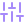
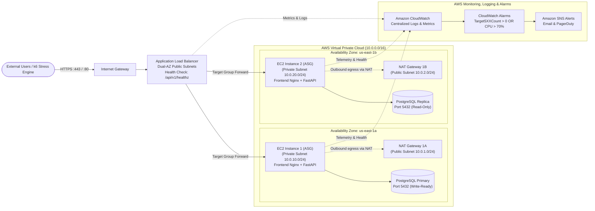
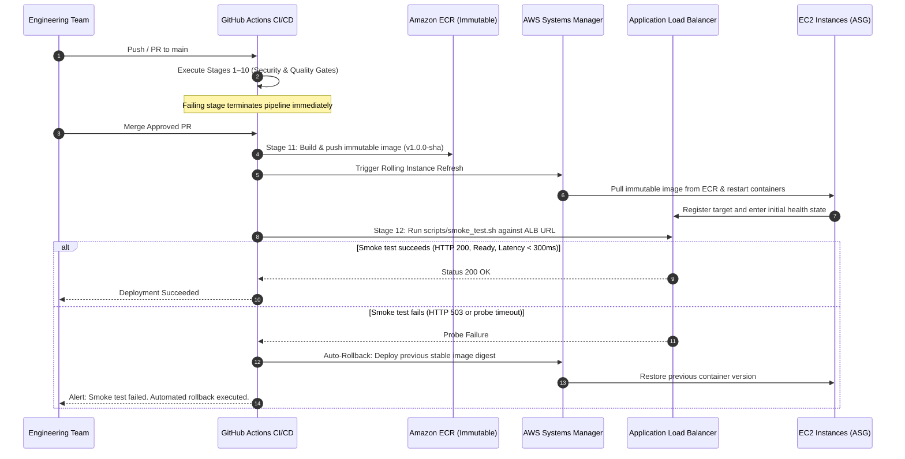
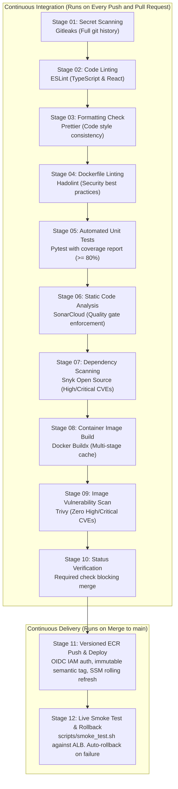

<p align="center">
  
</p>

<p align="center">
  
  
  
  
  
  
  
  
  
  
  
  
</p>

**PulseWatch** is an enterprise-grade cloud observability and synthetic uptime monitoring platform engineered for
mission-critical microservices. Inspired by industry standards like **Better Stack**, **Datadog**, and **Incident.io**,
PulseWatch continuously monitors distributed endpoints across global AWS edge locations, provides instant incident
triage, visualizes infrastructure topology in 3D, and executes autonomous self-healing rollbacks when health checks degrade.

---

## What's inside

| | Capability | Details |
|---|---|---|
|  | **Autonomous edge heartbeats** | Synthetic HTTP, SSL, and ICMP probes dispatched with sub-millisecond resolution and interactive 60-interval status strips. |
|  | **Global edge latency radar** | Multi-region latency probes across `us-east-1`, `eu-central-1`, `ap-south-1`, `ap-northeast-1`, and `sa-east-1`. |
|  | **3D interactive topology** | Three-dimensional visualizer of dual-AZ VPC, ALB routing, EC2 instances, and PostgreSQL primary/replica nodes. |
|  | **Public SLA status portal** | Client-facing status page tracking uptime guarantees, operational incidents, and SLA compliance readouts. |
|  | **DevOps & chaos lab** | Interactive evaluation playground for injecting 503 faults, triggering CloudWatch alarms, and simulating k6 CPU load spikes. |
|  | **Shift-left DevSecOps** | 12-stage mandatory pipeline: Gitleaks secret scan, ESLint, Prettier, Hadolint, Pytest (>80% cov), SonarCloud, Snyk, and Trivy CVE scanner. |
|  | **Hardened containerization** | Alpine-based multi-stage Docker builds, non-root system users (`appuser`, `nginx`), immutable ECR digests with semantic and commit-SHA tags. |
|  | **High availability & ASG** | Deployed across two Availability Zones in private subnets behind an Application Load Balancer with target-tracking auto-scaling (70% CPU). |
|  | **Automated smoke rollback** | Stage 12 post-deploy smoke verification; any probe failure immediately triggers an automatic rollback to the previous immutable ECR digest. |
|  | **CloudWatch observability** | Centralized structured logging, four-metric dashboard (request rate, errors, latency, CPU/memory), and automated SNS incident alerting. |
|  | **Resilient data tier** | Relational telemetry store with atomic snapshots, SHA-256 cryptographic verification, and automated retention pruning via `scripts/backup_db.sh`. |

---

## Architecture





---

## Required 12-Stage DevSecOps Pipeline

The deployment pipeline is partitioned into 10 pre-merge gates and 2 post-merge deployment stages. Security is enforced as code: any High or Critical finding immediately halts the workflow.



### Pipeline Stage Specification Matrix

| Stage | Name | Target / Tool | Enforcement Threshold |
| :---: | :--- | :--- | :--- |
| **01** | Secret Scanning | `gitleaks/gitleaks-action@v2` | Zero unencrypted secrets in full git history |
| **02** | Code Linting | ESLint 8 (`eslint-plugin-react`) | Zero lint errors and zero warnings (`--max-warnings 0`) |
| **03** | Formatting Check | Prettier (`prettier --check`) | 100% adherence to repository style specification |
| **04** | Dockerfile Linting | `hadolint/hadolint-action@v3.1.0` | Zero errors on multi-stage instructions and root user checks |
| **05** | Automated Tests | Pytest + `pytest-cov` | All unit tests pass with **coverage >= 80%** |
| **06** | Static Analysis | SonarCloud Quality Gate | Passed Quality Gate (A rating, zero security hotspots) |
| **07** | Dependency Scan | Snyk (`snyk/actions/python` & `node`) | Zero High or Critical CVEs in dependencies |
| **08** | Image Build | Docker Buildx (`docker/build-push-action`) | Deterministic multi-stage build using pinned Alpine digests |
| **09** | Image Scan | Aquasec Trivy (`aquasecurity/trivy-action`) | `exit-code: 1` on any High or Critical image vulnerability |
| **10** | Branch Protection | GitHub Actions Status Check | All 9 stages must be green before PR merge is permitted |
| **11** | Immutable Delivery | AWS OIDC + Amazon ECR + AWS SSM | Semantic tag (`v1.0.0`) + git commit SHA with tag immutability |
| **12** | Live Smoke Test | `scripts/smoke_test.sh` | Health probe `/api/v1/healthz` 200 OK + P99 latency < 300ms |

---

## Repository Layout

```
pulsewatch/
├── .github/
│   ├── dependabot.yml           # Automated daily dependency vulnerability tracking
│   └── workflows/
│       ├── devsecops-ci.yml     # Stages 1 to 10: Mandatory pull request validation
│       ├── cd-deploy.yml        # Stage 11 & 12: ECR push, rolling deploy & smoke test
│       └── rollback.yml         # Manual emergency rollback workflow with image tag input
├── frontend/                    # React 18 + Vite + Tailwind CSS + Lucide
│   ├── src/
│   │   ├── components/
│   │   │   ├── 3d/              # Isometric 3D AWS infrastructure topology
│   │   │   ├── dashboard/       # Telemetry studio, heartbeat strips & chaos lab
│   │   │   ├── landing/         # Marketing hero and capability pillars
│   │   │   ├── status/          # Public SLA status portal and incident timeline
│   │   │   └── ui/              # Reusable glassmorphic design system
│   │   ├── lib/api.ts           # Type-safe API client interface
│   │   └── types/index.ts       # Domain telemetry contracts
│   ├── nginx.conf               # Hardened unprivileged Nginx reverse proxy config
│   └── Dockerfile               # Multi-stage unprivileged Alpine container
├── backend/                     # FastAPI asynchronous observability microservice
│   ├── app/
│   │   ├── api/v1/              # Endpoints: /healthz, /ready, /monitors, /metrics
│   │   ├── core/                # Application configuration & security settings
│   │   ├── models/              # SQLAlchemy relational models
│   │   └── schemas/             # Pydantic validation schemas
│   ├── tests/                   # Pytest test suite enforcing >= 80% coverage
│   └── Dockerfile               # Multi-stage Alpine container running as 'appuser'
├── infra/                       # Cloud infrastructure definitions
│   ├── docker-compose.yml       # Local development stack
│   └── docker-compose.prod.yml  # Production multi-service stack for EC2 ASG instances
├── scripts/                     # Non-trivial shell & verification scripts
│   ├── smoke_test.sh            # Post-deploy health probe with automated rollback trigger
│   ├── backup_db.sh             # Atomic SQLite snapshot with SHA-256 integrity check
│   └── load_test.js             # k6 auto-scaling load spike script (CPU > 70%)
├── docs/assets/                 # Vector banner, custom SVG icons & architecture assets
├── SECURITY.md                  # Vulnerability disclosure protocol & scanner baselines
└── docker-compose.yml           # Root one-command local developer entrypoint
```

Each tier interacts strictly through validated contracts:
* **Frontend ⇄ Backend:** REST API contract validated via OpenAPI schemas (`/api/v1`).
* **Backend ⇄ Database:** SQLAlchemy ORM layer with atomic migrations and transactional safety.
* **Pipeline ⇄ AWS Infrastructure:** Short-lived GitHub OIDC authentication; zero hardcoded IAM keys in repository.

---

## Quick Start

### Prerequisites
* Docker & Docker Compose v2 installed locally.

```bash
# 1. Clone repository
git clone https://github.com/jabeen-zahra/PulseWatch.git
cd PulseWatch

# 2. Launch the complete containerized stack locally
docker compose up -d --build

# 3. Access local endpoints
# Frontend Studio & Status Page: http://localhost:80
# Backend OpenAPI Documentation: http://localhost:8000/docs
# Live Health Probe Endpoint:    http://localhost:8000/api/v1/healthz
```

---

## Shell Script Automation

The project includes two production-grade shell scripts and one k6 stress test script, each strictly adhering to `set -euo pipefail` and passing ShellCheck audits:

### 1. Post-Deployment Smoke Verification (`scripts/smoke_test.sh`)
* **Pipeline Integration:** Executed automatically during Stage 12 of the CD workflow.
* **Checks Executed:**
  1. Polls ALB health endpoint `GET /api/v1/healthz` with retry backoff.
  2. Asserts container readiness via `GET /api/v1/ready`.
  3. Executes functional synthetic monitor creation transaction (`POST /api/v1/monitors`).
  4. Measures round-trip HTTP latency, asserting P99 SLA is strictly under 300ms.
* **Self-Healing Action:** Returns exit code `1` upon any probe failure, instructing GitHub Actions to trigger immediate container rollback.

### 2. Database Backup & Cryptographic Checksum (`scripts/backup_db.sh`)
* **Integrity Guarantee:** Takes an atomic snapshot of the relational database.
* **Cryptographic Verification:** Generates a SHA-256 integrity checksum file and verifies digest consistency before saving.
* **Retention Policy:** Automatically identifies and prunes backup archives older than 7 days.

### 3. Auto-Scaling Stress Engine (`scripts/load_test.js`)
* **Execution:** Run with `k6 run scripts/load_test.js`.
* **Behavior:** Ramps up concurrent virtual users from 50 to 400 against the ALB to force CPU utilization past 70%, triggering AWS Auto Scaling scale-out.

---

## AWS Production Infrastructure Specification

The application is deployed across two AWS Availability Zones (`us-east-1a` and `us-east-1b`) in a highly available, multi-tier Virtual Private Cloud:

1. **Virtual Private Cloud (VPC):**
   * Primary CIDR: `10.0.0.0/16`.
   * Public Subnet 1A: `10.0.1.0/24` | Public Subnet 1B: `10.0.2.0/24`.
   * Private Subnet 1A: `10.0.10.0/24` | Private Subnet 1B: `10.0.20.0/24`.
   * Internet Gateway attached to Public Subnets. Dedicated NAT Gateways in each AZ provide secure egress for private subnets.
2. **Security Groups:**
   * `sg-pulsewatch-alb`: Ingress allowed on ports 80/443 from `0.0.0.0/0`.
   * `sg-pulsewatch-instances`: Ingress allowed on port 80 **strictly from `sg-pulsewatch-alb`**. Port 22 (SSH) is completely blocked; all administrative access is handled via AWS Systems Manager Session Manager.
3. **Application Load Balancer (ALB):**
   * Multi-AZ Internet-facing ALB with cross-zone load balancing enabled.
   * Target Group configured with HTTP health checks on `/api/v1/healthz` (Interval: 15s, Healthy Threshold: 2, Unhealthy Threshold: 2).
4. **Auto Scaling Group (ASG):**
   * Minimum: 2 instances | Maximum: 4 instances | Desired: 2 instances spanning `us-east-1a` and `us-east-1b`.
   * Target Tracking Policy: `ASGAverageCPUUtilization` set to **70%**.
   * Launch Template uses Amazon Linux 2023 minimal AMI with Docker Compose configured in UserData.
5. **Observability & Alerting:**
   * Centralized logging configured via CloudWatch Log Groups.
   * Alarm 1: `PulseWatch-UnhealthyTargetCount` (triggers when `UnHealthyHostCount >= 1`).
   * Alarm 2: `PulseWatch-HighCPU` (triggers when `CPUUtilization > 75%` for 2 minutes).
   * Notifications: Both alarms publish to SNS topic `pulsewatch-incident-alerts` for instant notification.

---

## Demonstrations & Viva Runbook

### 1. High Availability & Failure Recovery
1. Open the PulseWatch dashboard in a browser.
2. In the AWS Console or via the **DevOps Lab** interface, terminate an EC2 instance in `us-east-1a` or click **Inject Failure (Trigger 503 Alarm)**.
3. Observe the Application Load Balancer detecting the failure within 15 seconds, taking the unhealthy instance out of rotation.
4. Active user sessions remain completely uninterrupted as the second instance in `us-east-1b` serves all traffic without downtime.
5. The Auto Scaling Group launches a healthy replacement instance automatically.

### 2. Auto-Scaling Under Load
1. Launch the load test script:
   ```bash
   k6 run scripts/load_test.js
   ```
2. Navigate to CloudWatch Metrics to observe CPU utilization exceeding the 70% target.
3. Within 3 minutes, the Auto Scaling Group initiates a Scale-Out event, launching 2 additional instances across both AZs (total: 4 instances).
4. Once the load test terminates, the target tracking policy gracefully cools down and scales the group back in to 2 instances.

### 3. Automated & Manual Rollback
* **Automated Rollback:** Pushing a commit that breaks `/api/v1/healthz` causes Stage 12 (`smoke_test.sh`) to exit with code `1`. GitHub Actions immediately intercepts this failure and re-deploys the previous stable ECR image digest.
* **Manual Emergency Rollback:** Navigate to **Actions** → **Manual Emergency Rollback Workflow** → enter the target version (e.g. `v1.0.0`) → click **Run workflow**.

---

## Engineering Team & Contribution Ledger

| Member | Contact | Ownership & Contributions |
| :--- | :--- | :--- |
| **Jabeen Zahra** | `kaneezezahra313@gmail.com` | **Architecture, Microservices & Frontend Platform Lead**<br>• Designed React 18 observability interface, 3D topology visualizer & status portal.<br>• Engineered FastAPI REST API with health probes (`/healthz`, `/live`, `/ready`).<br>• Implemented GitHub Actions CI Stages 1–4 and root Docker Compose setup. |
| **Fatima Ijaz** | `f6618568@gmail.com` | **DevSecOps, Security Auditing & Container Hardening Specialist**<br>• Hardened Alpine multi-stage Dockerfiles with unprivileged users (`appuser`, `nginx`).<br>• Integrated Gitleaks secret scanner, Snyk dependency audits, and Trivy CVE scanning.<br>• Authored `SECURITY.md`, ShellCheck-compliant `scripts/backup_db.sh`, and Dependabot policy. |
| **Mirfaq Javaid** | `mirfaqjavaid@gmail.com` | **Cloud Infrastructure, Observability & Continuous Delivery Lead**<br>• Configured AWS Dual-AZ VPC, subnets, ALB routing, and Auto Scaling target tracking.<br>• Built OIDC IAM authentication, Amazon ECR immutable versioning, and rolling updates.<br>• Authored Stage 12 `scripts/smoke_test.sh` with automated rollback and k6 load testing script. |

---

## Infrastructure Teardown

```bash
# Terminate local stack
docker compose down -v

# AWS Resource Decommissioning
aws autoscaling delete-auto-scaling-group --auto-scaling-group-name pulsewatch-asg --force-delete
aws elbv2 delete-load-balancer --load-balancer-arn <ALB_ARN>
aws ec2 delete-vpc --vpc-id <VPC_ID>
```
